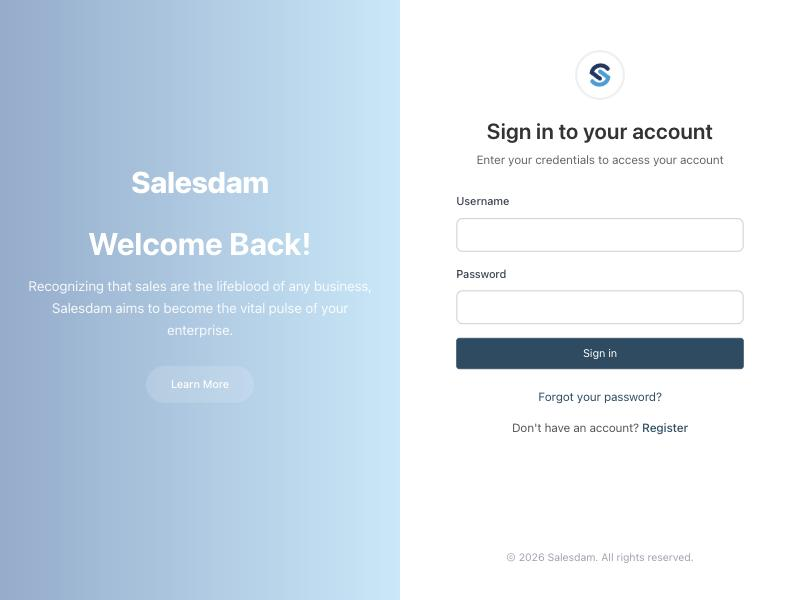
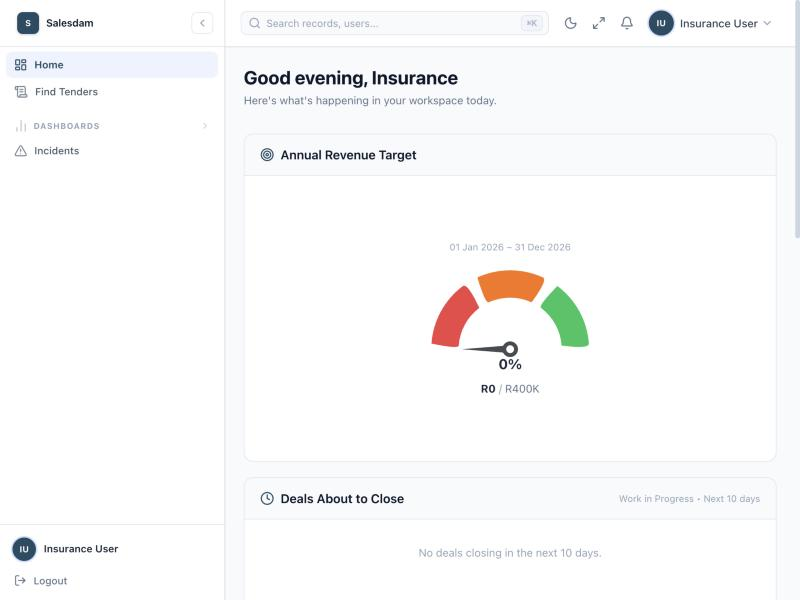
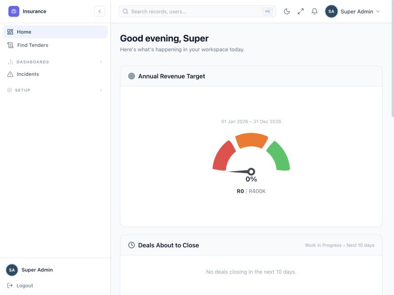
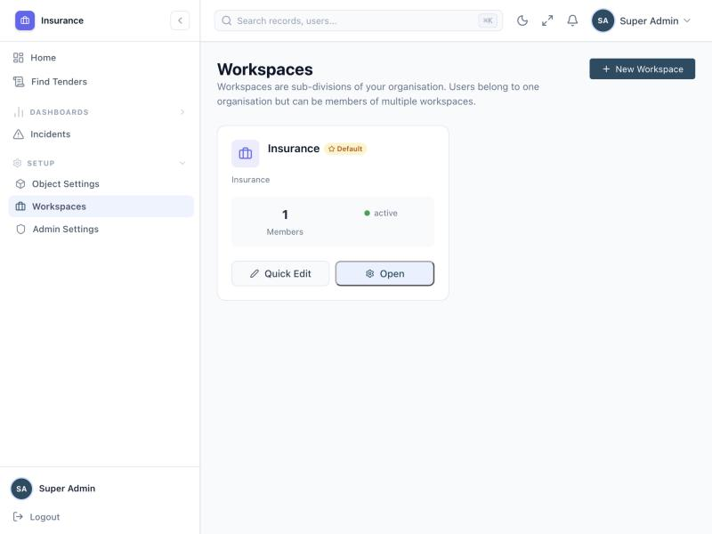
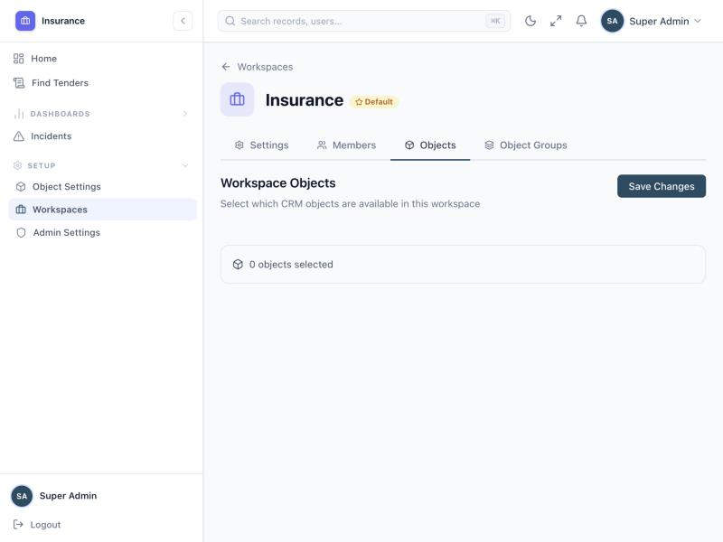
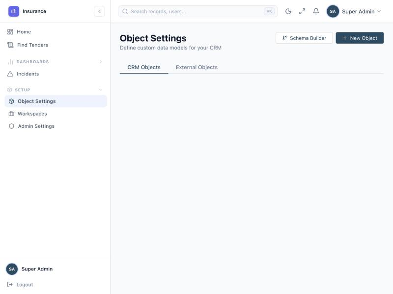
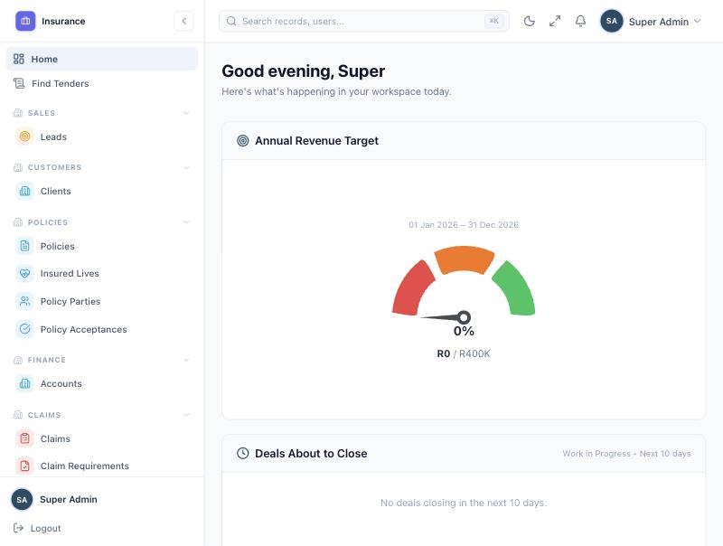
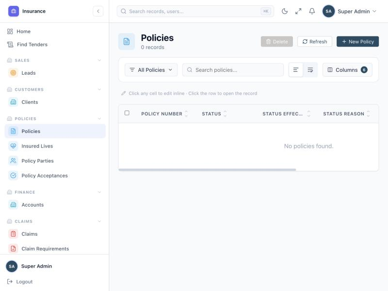

# Salesdam Insurance Module — Step-by-Step Guide

Generated 2026-10-12 by walking the running dev app (`superadmin` / `insuranceuser`
test accounts, tenant "Salesdam") and cross-checking it against the backend
routes and the tenant database. Screenshots are embedded where the UI actually
shows something; steps with no UI yet are given as API calls instead.

## 1. Current state (read this first)

The insurance **engine is real and tested** — 15+ metadata objects, application →
pricing → approval → issue → servicing → endorsement → claims, all behind
`/api/v1/insurance/*` and covered by passing e2e suites (see
[IMPLEMENTATION_PLAN.md](IMPLEMENTATION_PLAN.md)).

The insurance **UI is now wired up** for the "Salesdam" tenant. Original state,
root cause, and the fix:

- The Insurance workspace existed (Setup → Workspaces → Insurance, marked
  **Default**), but its Objects tab showed **"0 objects selected"** and Object
  Groups was empty — so Policy/Claim/Product/etc. never appeared as sidebar
  items or record screens, for any user, including Super Admin.
- Root cause: the Salesdam tenant had **no standard-object metadata records at
  all** (`client`, `lead`, `deal`, …) — those render in the UI from a
  static/code-defined schema, not from the database. The official seeder,
  `backend/scripts/seed-insurance-objects.js`, refuses to run against a tenant
  without that metadata, which is why insurance objects were never created for
  this tenant. The 15 insurance objects only existed inside ~100 disposable
  `ZZ_INS*` tenants left behind by the e2e test suite, with no users or
  workspaces to log into.
- **Fix applied:** `backend/scripts/backfill-salesdam-insurance.mjs` (idempotent,
  safe to re-run) seeded 14 standard-object metadata records, then 20 insurance
  object records, then scoped the existing "Insurance" workspace's
  `allowedObjects`/`objectGroups` to exactly those 16 nav-worthy objects (so the
  sidebar shows only insurance-relevant items, not every standard object). No
  existing field schema, role, or page was touched or duplicated — the Leads
  screen, for example, renders the exact same RFQ/tender fields it did before.

**Remaining known gap:** the `standard_user` role (used by the seeded
`insuranceuser` test account) still has no object permissions on the new
insurance objects — only `superadmin` (superuser role, which bypasses
object-permission checks) can use them right now. That's Stage 2 permissions
work from [IMPLEMENTATION_PLAN.md](IMPLEMENTATION_PLAN.md) and hasn't been done
here since it's a permissions/access change, not a data backfill.

## 2. Before / after (evidence)

### 2.1 Login

Standard Salesdam login — `Username` + `Password` (not email).

### 2.2 Dashboard as a standard user (`insuranceuser`)

No Insurance-related navigation anywhere in the sidebar.

### 2.3 Dashboard as Super Admin

The sidebar header does say **"Insurance"** (the tenant's one workspace), and a
**Setup** section appears — but still no Policy/Claim/Product menu items.

### 2.4 Workspace switcher

"Insurance" is the only workspace in this tenant.

### 2.5 Workspaces management (Setup → Workspaces)

### 2.6 Insurance workspace → Objects tab

This is the direct evidence: **0 objects selected**.

### 2.7 Setup → Object Settings

The platform's object manager also shows nothing, because it only lists
custom (database-defined) objects, and none exist for this tenant yet.

### 2.8 After the backfill: sidebar wired up

Sales → Leads, Customers → Clients, Policies → Policies / Insured Lives /
Policy Parties / Policy Acceptances, Finance → Accounts, Claims → Claims /
Claim Requirements, and more below the fold.

### 2.9 After the backfill: a real Policies screen

Full generic object screen — columns, search, inline edit, "New Policy".

## 3. Step-by-step: using the insurance module today (API)

Backend runs on `http://localhost:5002`. All calls are session-cookie
authenticated and tenant-scoped. Use `superadmin` / `SuperAdmin123!` — the
seeded `insuranceuser` test account currently has no object permissions on any
insurance object and gets a 403.

| # | Step | Call |
|---|------|------|
| 1 | Log in | `POST /api/v1/auth/login` `{"username":"superadmin","password":"SuperAdmin123!"}` |
| 2 | Seed the workspace (one-time) | `npm run seed:insurance` in `backend/` — creates the 15 objects for a tenant with `hub: 'insurance'` |
| 3 | Create a Product | `POST /api/v1/insurance/products` `{"name":"Funeral Plan","status":"active"}` |
| 4 | Create a Product Version | `POST /api/v1/insurance/product-versions` (ages, `requires_approval`, etc.) |
| 5 | Add rates | `POST /api/v1/insurance/benefit-covers` (cover amount + premium per rate category) |
| 6 | Start an application | `POST /api/v1/insurance/applications` `{"channel":"website","product_version_id":"..."}` → auto `POL-...` number |
| 7 | Capture main member | `PUT /api/v1/insurance/applications/:id/main-member` |
| 8 | Capture premium payer | `PUT /api/v1/insurance/applications/:id/premium-payer` |
| 9 | Capture acceptance | `POST /api/v1/insurance/applications/:id/acceptance` |
| 10 | Submit | `POST /api/v1/insurance/applications/:id/submit` → prices it, status → `application_submitted` |
| 11 | Approve (if required) | `GET /api/v1/insurance/policies/:id/approvals` then `POST /api/v1/insurance/approvals/:id/approve` |
| 12 | Issue | `POST /api/v1/insurance/policies/:id/issue` → status → `active`, documents auto-generated |
| 13 | Service it | `POST /api/v1/insurance/policies/:id/{lapse\|reinstate\|suspend\|reactivate\|cancel\|close}` |
| 14 | Endorse it | `POST /api/v1/insurance/policies/:id/endorsements`, then `{submit\|approve\|reject\|apply\|cancel}` |
| 15 | File a claim | `POST /api/v1/insurance/claims`, add requirements, `POST /claims/:id/transition`, `POST /claims/:id/payments` |

Full request/response bodies for every step: [USER_MANUAL.md](USER_MANUAL.md).

## 4. Permissions — done

`backend/scripts/grant-insurance-permissions.mjs` (idempotent, safe to re-run)
granted the `standard_user` and `admin` roles full CRUD + field permissions on
all 20 insurance-pack objects plus `account`, reading field lists from the
real `FieldMeta` records so they match what's actually in the database.
Verified: the seeded `insuranceuser` test account can now open Policies,
Claims, etc. directly (no 403), confirmed both via the API and by logging in
as that user in the browser.

**One small cosmetic item left:** `insuranceuser` isn't a *member* of the
"Insurance" workspace, so their sidebar lists every object alphabetically
instead of grouped under Sales/Policies/Claims/etc. the way `superadmin` sees
it. Adding them (and other `standard_user` accounts) as workspace members
would fix that — not done here since it's a membership change, not a
permissions one.
